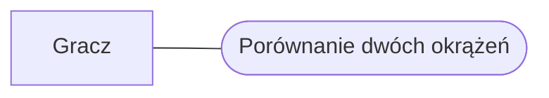
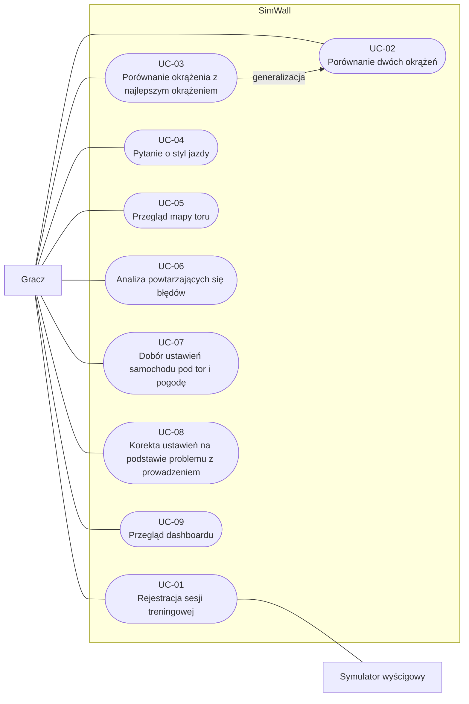
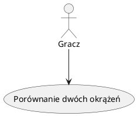
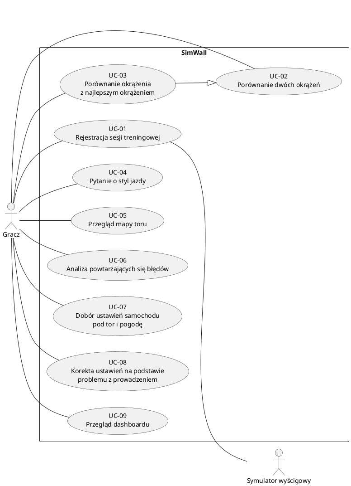

# Przypadki użycia

## Wersja Mermaid

### 1. Aktor i przypadek użycia

### 2. Granice systemu i generalizacja

## Wersja PlantUML — zgodna z notacją UML

### 1. Aktor i przypadek użycia

### 2. Granice systemu i generalizacja

## Katalog przypadków użycia

| ID | Przypadek użycia | Aktor | Wymagania |
|----|------------------|-------|-----------|
| [UC-01](UC-01-record-session.md) | Rejestracja sesji treningowej | Gracz, Symulator wyścigowy | FR-01, FR-12, NFR-04 |
| [UC-02](UC-02-compare-laps.md) | Porównanie dwóch okrążeń | Gracz | FR-02, FR-03, FR-04 |
| [UC-03](UC-03-compare-with-best-lap.md) | Porównanie okrążenia z najlepszym okrążeniem | Gracz | FR-02, FR-03, FR-04 |
| [UC-04](UC-04-ask-about-driving-style.md) | Pytanie o styl jazdy | Gracz | FR-05, NFR-02 |
| [UC-05](UC-05-view-track-map.md) | Przegląd mapy toru | Gracz | FR-08, FR-09, FR-10, NFR-03 |
| [UC-06](UC-06-analyze-recurring-mistakes.md) | Analiza powtarzających się błędów | Gracz | FR-11, FR-04, NFR-01 |
| [UC-07](UC-07-recommend-car-setup.md) | Dobór ustawień samochodu pod tor i pogodę | Gracz | FR-06, NFR-02 |
| [UC-08](UC-08-fix-handling-problem.md) | Korekta ustawień na podstawie problemu z prowadzeniem | Gracz | FR-07, NFR-02 |
| [UC-09](UC-09-view-dashboard.md) | Przegląd dashboardu | Gracz | FR-13 |
